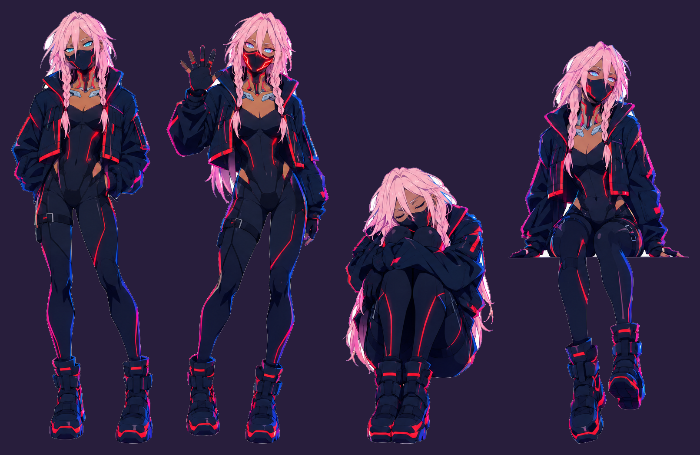
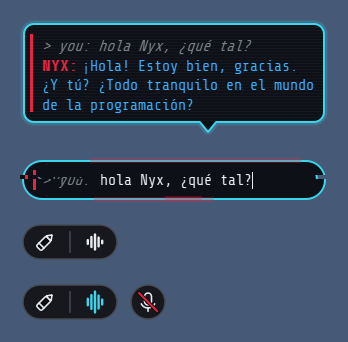
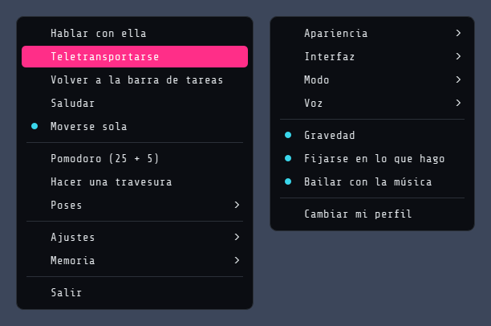
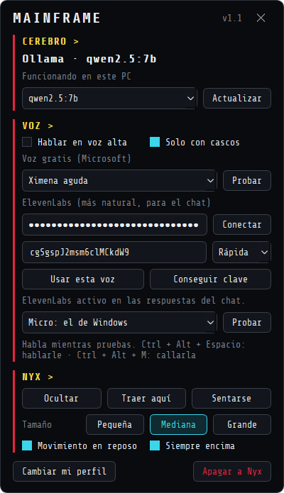

# Nyx · compañera de escritorio netrunner

Nyx es una chica netrunner que vive en tu escritorio de Windows. Se sienta encima de las ventanas, se teletransporta como un rayo, te habla con voz y recuerda lo que le cuentas. Su cerebro es una IA que funciona **en tu propio PC** con [Ollama](https://ollama.com): es gratis y lo que le dices no sale de tu ordenador.



## Qué hace

**Habla contigo**
- Chat en un bocadillo estilo terminal, que se escribe letra a letra.
- Llamada por voz: le hablas, detecta cuándo terminas y te contesta en voz alta.
- Voces gratis de Microsoft o, si quieres, de ElevenLabs.
- Modo «solo con cascos», para que no hable por los altavoces en clase.
- Habla en español de España y pone cara según lo que dice: pensativa, riéndose, enfadada o sorprendida.

**Te conoce**
- Recuerda las conversaciones y va apuntando cosas sobre ti.
- Sabe qué programa tienes abierto y te lo comenta («¿otra vez jugando?»).
- Recordatorios en lenguaje normal: «recuérdame el examen el jueves a las 10».
- Pomodoro de estudio. Si abres un juego mientras dura, te riñe.

**Vive en el escritorio**
- La puedes arrastrar y lanzar: cae con gravedad y se sienta en el borde de las ventanas.
- Se teletransporta con un rayo de una ventana a otra.
- Baila cuando suena Spotify.
- De vez en cuando hace travesuras con efectos glitch.




## Ajustes

Clic derecho en Nyx para abrir el menú, o **Mainframe** para la ventana de ajustes: cerebro (modelo de IA), voz, micrófono, tamaño y apariencia.

<p>
  
  
</p>

| Atajo | Qué hace |
|---|---|
| Ctrl + Alt + N | Escribirle |
| Ctrl + Alt + Espacio (mantener) | Hablarle por voz |
| Ctrl + Alt + M | Callarla |

## Instalar

**Opción fácil:** descarga `Nyx-Setup.exe` desde [Releases](../../releases) y ejecútalo. La primera vez te pregunta tu nombre, te ayuda a instalar Ollama y descarga el modelo (unos 6,6 GB).

**Desde el código:**
```bash
python -m venv .venv
.venv\Scripts\pip install -r requirements.txt
.venv\Scripts\python nyx.py
```

Requisitos: Windows 10/11, una gráfica con unos 6 GB de memoria y [Ollama](https://ollama.com/download/windows).

Para generar el instalador: `pyinstaller nyx.spec --noconfirm` y después compilar `installer.iss` con [Inno Setup](https://jrsoftware.org/isinfo.php).

## Cómo está hecho

- **Python + PySide6** para las ventanas transparentes, las animaciones y el menú.
- **Ollama + Gemma 4 E4B** como cerebro. La personalidad está en `Modelfile`.
- **faster-whisper** para entender la voz y **edge-tts** / ElevenLabs para hablar.
- Llamadas a la API de Windows (ctypes) para detectar ventanas, atajos globales y la ventana activa.
- Las imágenes de Nyx se generaron con IA y se recortaron con `tools/cut_sprites.py`, que quita el fondo y separa las poses.

## Créditos

La interfaz de terminal, el teletransporte y el Mainframe están inspirados en [capri-desktop](https://github.com/lachydotmcg/capri-desktop), de Lachy (licencia PolyForm Noncommercial 1.0.0). Más detalles en [NOTICE.txt](NOTICE.txt).

Proyecto personal sin ánimo de lucro, hecho por **cIZeroN**.
